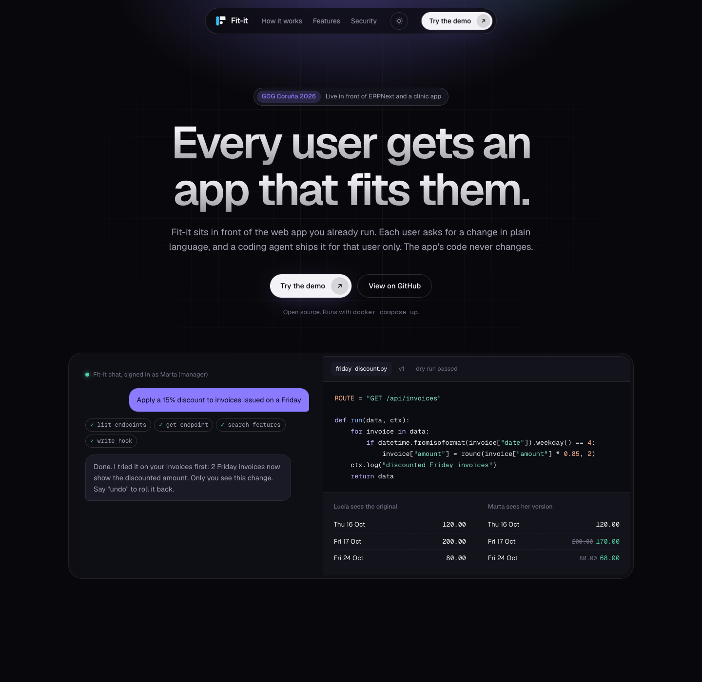
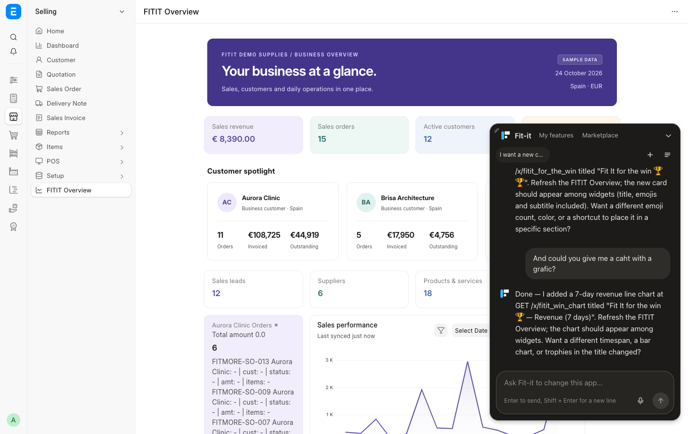
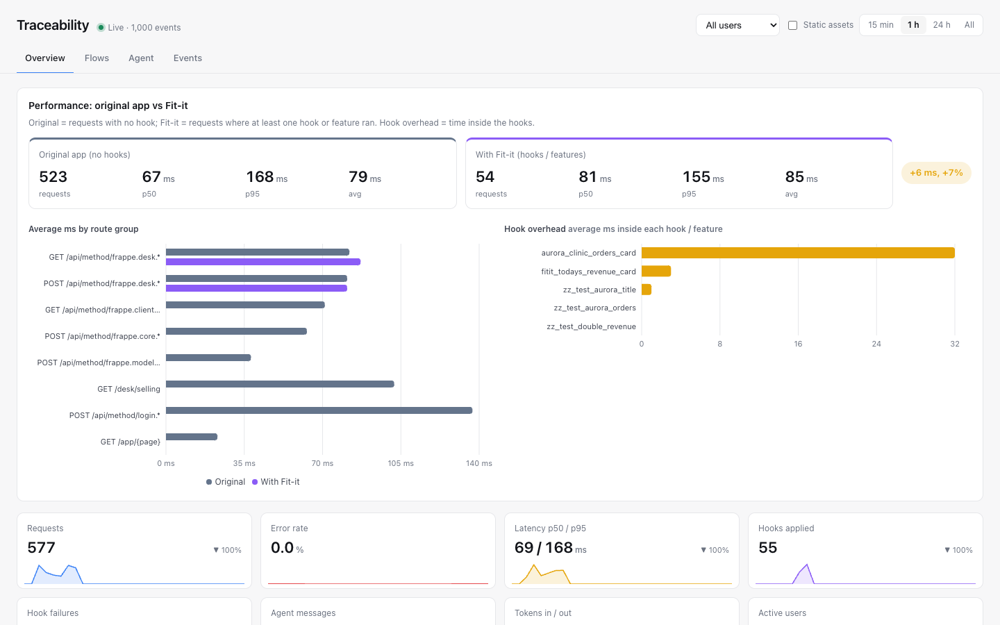
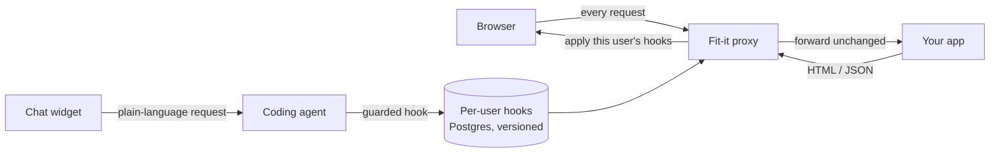

<p align="center">
  
</p>

<h1 align="center">Fit-it</h1>

<p align="center"><b>Every user gets an app that fits them. Zero code changes.</b></p>

<p align="center">
  
  
  
  
  
  
</p>

<p align="center"></p>

Fit-it is a reverse proxy that sits in front of the web app you already run. Each user asks for a change in plain language, a coding agent compiles it into a small Python hook scoped to that user, and the proxy applies it to every request and response from then on. The app's code never changes.

## See it in action

**Live in front of ERPNext.** The Fit-it chat panel runs on top of the unchanged ERPNext desk. A user asks for a card or a chart, the agent explores the app's API, writes the hook, dry-runs it and the result shows up on that user's page only.

<p align="center"></p>

**Everything is traced.** Latency of the original app versus Fit-it, per-hook overhead, agent turns, tokens and every event.

<p align="center"></p>

## How it works



1. The browser talks only to Fit-it; the proxy forwards each request to the original app.
2. On the way back, the user's hooks rewrite the JSON or HTML, and the chat widget is injected into the page.
3. Hooks that need more data call the app's own API with the user's own session, so a hook never sees more than that user already can.

## Features

- **Per-user hooks**: every change is scoped to the user who asked for it, versioned, and can be rolled back.
- **Safety sandbox**: generated code passes an AST guard, runs fail-closed, and reaches the app only through its API with the user's session.
- **Marketplace**: publish a feature you built and let other users install it in one click.
- **Cards and charts**: ask for a KPI card or a chart and it appears on your page in the app's own look.
- **Traceability**: prompts, generated code, validation results, diffs and latency, in a live dashboard and in Jaeger.
- **Any model**: Anthropic, OpenAI or a local Ollama model through one `FITIT_MODEL` setting.

## Quick start

Demo clinic app behind Fit-it:

```bash
export ANTHROPIC_API_KEY=...        # in your shell, never in a file
docker compose up --build           # http://localhost:8000
```

ERPNext behind Fit-it: bootstrap the sandbox as described in [integrations/erpnext/README.md](integrations/erpnext/README.md) (it asks for the passwords in your shell), then:

```bash
bash integrations/erpnext/bootstrap.sh
docker compose -p fitit-demo -f compose.yaml -f integrations/erpnext/compose.fitit.yaml up -d --build core
```

Open http://localhost:8000/desk/selling/fitit-overview and log in as Administrator.

## Documentation

- [Docs index](docs/README.md): architecture, ADRs, specs, epics and iteration plans
- [Architecture overview](docs/architecture/overview.md)
- [Product vision](docs/product/vision.md) and [demo script](docs/product/demo-script.md)
- [Traceability](docs/traceability.md)
- [Contribution rules](AGENTS.md)

## Development

### How the proxy works

1. The browser talks only to the Fit-it core, never directly to the client app.
2. The core loads the user's hooks from its own Postgres (`hooks` table, every saved version kept in `hook_versions`).
3. The request is forwarded to the original app.
4. The app returns its normal HTML or JSON.
5. The hook runner mutates the JSON with the user's hooks, or injects the `embed.js` chat widget into the HTML.
6. The personalized response goes back to the user.

Hooks that need more data call the app's own API with the user's own session (`ctx.api`), so a hook can never see more than that user already can. The agent learns the available endpoints from the app's OpenAPI spec. Every change is traced: prompt, generated code, validation result and diff.

Architecture diagrams live in `.artifacts/pages/` (open the HTML files in a browser). `reverse-proxy-flow.html` is the current design.

### Status

Hackathon prototype (GDG Coruña, October 2026). `backend/` holds the first iteration: a per-user hook pipeline with an AST guard and fail-closed execution.

```bash
export ANTHROPIC_API_KEY=...                            # in your shell, never in a file
docker compose up --build                               # API :8000, Jaeger http://127.0.0.1:16686
make check                                              # Docker tests, no model calls
```

The audit journal and Jaeger view are in [docs/traceability.md](docs/traceability.md).

### Choosing the model

`FITIT_MODEL` takes any Pydantic AI `provider:model` string; export the key that provider reads ([ADR 0014](docs/adr/0014-provider-agnostic-model.md)).

```bash
export ANTHROPIC_API_KEY=...                                 # default: anthropic:claude-opus-5-5
export FITIT_MODEL=openai:gpt-5 OPENAI_API_KEY=...           # OpenAI
export FITIT_MODEL=ollama:qwen3 OLLAMA_BASE_URL=http://host.docker.internal:11434/v1   # local Ollama
```

Contribution rules (Git Flow, Conventional Commits, PRs) are in `AGENTS.md`.
